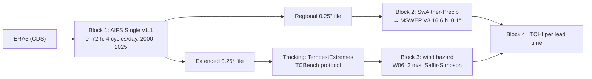

# AITCHazard Mexico

AI-based forecasting of tropical cyclone (TC) hazard over Mexico: AIFS hindcasts,
precipitation downscaling, TC tracking, wind hazard and an integrated hazard index.

AITCHazard is the forecast layer of **ITCHI** (Integrated Tropical Cyclone Hazard Index,
[`apereze/itchi-core`](https://github.com/apereze/itchi-core)): it produces from AIFS
forecasts the same inputs that ITCHI uses for the observed hazard, so the index can be
computed at each lead time and compared with observations.

## Status (2026-11-08)

| Component | Status |
|---|---|
| Block 1 · AIFS Single v1.1 + ERA5 | Environment validated; one-day benchmark (12.6 s per 72 h forecast, ~80–100 GPU-h for the campaign); Emily 2005 case. Production runner pending |
| Block 2 · SwAIther-Precip | Design decided (MSWEP V3.16 6 h, INEGI DEM); no code |
| TC tracking · TempestExtremes + TCBench | Design decided; no code (illustrative tracker in `plot_case.py`) |
| Blocks 3–4 · wind hazard and ITCHI | Scheme decided (follow ITCHI); intensity correction open |

Details: [`docs/framework.md`](docs/framework.md) (diagram and data contracts) and
[`docs/decisions.md`](docs/decisions.md).

## Workflow



## Repository layout

```text
conf/aitchazard_mexico/   YAML configuration (Block 1 in use; Block 2 and tracking/wind as design)
containers/               Container notes (AIFS 1.1 environment)
data/                     Local staging only (ignored by Git); campaign data live on /work
docs/                     Framework, decisions, block documents, Curnagl guide, results
notebooks/                02: one-day Block 1 benchmark
outputs/                  Local outputs (ignored by Git)
scripts/block1/           Preflight, ERA5 download, case figures
slurm/                    SLURM jobs for Curnagl
src/aitchazard/block1/    Calendar, ERA5 reader, CDS parameters, batched regridding
tests/block1/             Unit tests (no network, no GPU)
```

## Quick start on Curnagl

See [`docs/curnagl-guide.md`](docs/curnagl-guide.md) for the step-by-step version.

```bash
cd /work/FAC/FGSE/IDYST/tbeucler/default/apereze/repos/AITCHazard_Mexico
module load apptainer/1.4.1
BASE=/work/FAC/FGSE/IDYST/tbeucler/default/apereze
SIF=$BASE/aifs/aifs_single_v2_era5.sif
PYLIBS=$BASE/aifs/pylibs/aifs11

# checks, checkpoint and ERA5 of one day (login node)
apptainer exec --bind /work --env PYTHONPATH=$PYLIBS $SIF \
    python scripts/block1/bench_preflight.py --base $BASE --day 2005-05-15 --try-load
# one-day benchmark on a GPU
sbatch slurm/block1_bench_day.slurm
```

Unit tests: `python -m pytest tests` (needs `numpy`, `scipy`, `pytest`).

## Documentation

| File | Content |
|---|---|
| [`docs/framework.md`](docs/framework.md) | Architecture, diagram, data contracts between blocks |
| [`docs/decisions.md`](docs/decisions.md) | Decided and open questions |
| [`docs/block1-aifs.md`](docs/block1-aifs.md) | AIFS 1.1 + ERA5: design, environment, benchmark |
| [`docs/block2-swaither.md`](docs/block2-swaither.md) | SwAIther-Precip adaptation (MSWEP V3.16, INEGI DEM) |
| [`docs/tracking-tcbench.md`](docs/tracking-tcbench.md) | TempestExtremes with the TCBench protocol |
| [`docs/hazard-itchi.md`](docs/hazard-itchi.md) | Wind hazard and forecast ITCHI |
| [`docs/curnagl-guide.md`](docs/curnagl-guide.md) | Step-by-step commands on Curnagl |
| [`docs/results/`](docs/results/) | Dated results (benchmark, Emily 2005) |
| [`docs/presentations/`](docs/presentations/) | Material for progress presentations |
| [`docs/data-governance.md`](docs/data-governance.md) | What goes into Git and what does not |

## Data governance

Do not commit NetCDF, GRIB, Zarr, checkpoints, logs or credentials (`.cdsapirc`). Campaign
data live under `/work/FAC/FGSE/IDYST/tbeucler/default/apereze/` (see `data/README.md`).

## Contributors

- Adolfo Pérez Estrada, Universidad Nacional Autónoma de México / University of Lausanne.
- Milton Gomez, University of Lausanne.
- Christian Domínguez, Universidad Nacional Autónoma de México.
- Tom Beucler, University of Lausanne.

## License

MIT (see `LICENSE.md`). If SwAIther-Precip code is copied, keep its Apache-2.0 notices.
