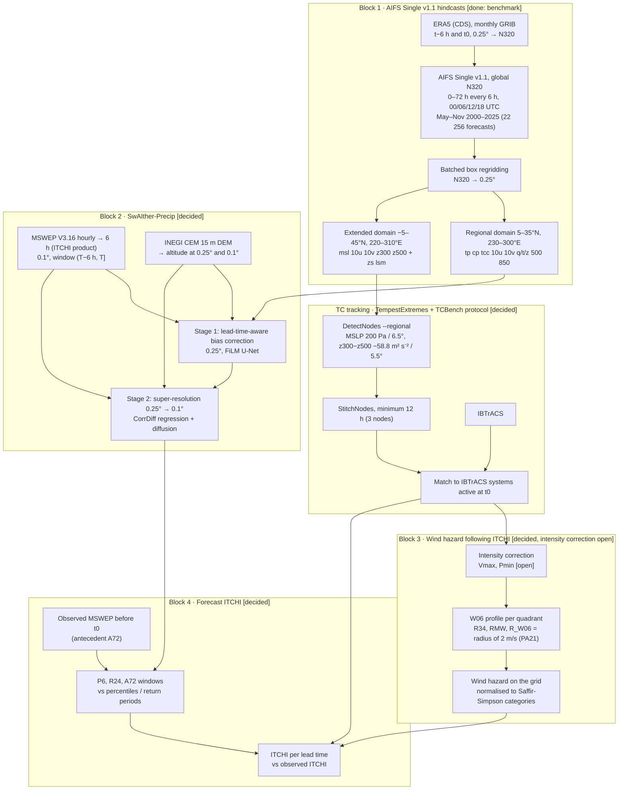

# AITCHazard framework

Last updated: 2026-11-08.

AITCHazard is the **forecast layer of ITCHI** (Integrated Tropical Cyclone Hazard
Index, [`apereze/itchi-core`](https://github.com/apereze/itchi-core), v0.2.1). ITCHI
measures the tropical cyclone (TC) hazard that was **observed** over Mexico
(MSWEP precipitation + parametric wind from best tracks). AITCHazard produces the same
inputs from **AIFS forecasts** so that ITCHI can be computed at each lead time and
compared with the observed ITCHI (ITCHI v0.3 plan, phase F5).

Status labels used in this document: **[done]** implemented and tested on Curnagl,
**[decided]** agreed but not implemented, **[open]** to be decided.

## Diagram

## Blocks

| Block | Purpose | Main output | Document |
|---|---|---|---|
| 1 | AIFS Single v1.1 hindcasts initialised from ERA5 | NetCDF per forecast, regional and extended domains | [`block1-aifs.md`](block1-aifs.md) |
| 2 | Bias correction and downscaling of 6 h precipitation | P6 at 0.1° per valid time and lead | [`block2-swaither.md`](block2-swaither.md) |
| Tracking | TC centre, track, Vmax and Pmin per forecast | Track tables matched to IBTrACS | [`tracking-tcbench.md`](tracking-tcbench.md) |
| 3–4 | Wind hazard and integrated index, following ITCHI | ITCHI inputs and ITCHI per lead time | [`hazard-itchi.md`](hazard-itchi.md) |

## Data contracts between blocks

| Product | Producer | Consumer | Grid | Time convention | Units |
|---|---|---|---|---|---|
| AIFS regional file | Block 1 | Block 2 | 0.25°, 5–35°N, 230–300°E | `lead_time` 0–72 h, `valid_time`; tp/cp NaN at t0 | tp, cp in m per 6 h; z in m² s⁻² |
| AIFS extended file | Block 1 | Tracking | 0.25°, −5–45°N, 220–310°E | same | msl in Pa; z in m² s⁻² |
| Static file | Block 1 | Blocks 2 and tracking | per domain | none | zs in m; lsm 0–1 |
| MSWEP 6 h | ITCHI preprocessing | Blocks 2 and 4 | 0.1°, 5–35°N, 220–300°E | value at T = sum of (T−6 h, T], T in 00/06/12/18 UTC; NaN if an hour is missing | mm per 6 h |
| Altitude | INEGI CEM | Block 2 | 0.25° and 0.1° | static | m |
| Track table | Tracking | Blocks 3 and 4 | points | init, lead, valid time | lat, lon (0–360), Vmax (m s⁻¹ and kt), Pmin (hPa) |
| Wind hazard | Block 3 | Block 4 | 0.1° (MSWEP grid) | valid time | 0–1 |

AIFS `tp` at valid time T is the precipitation of (T−6 h, T], the same window as the
MSWEP 6 h product (verified in the benchmark: AIFS precipitation is per step, not
accumulated from t0).

## Decisions and open questions

See [`decisions.md`](decisions.md).
