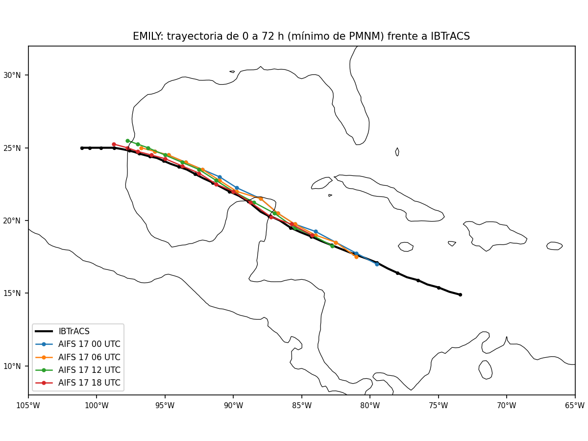
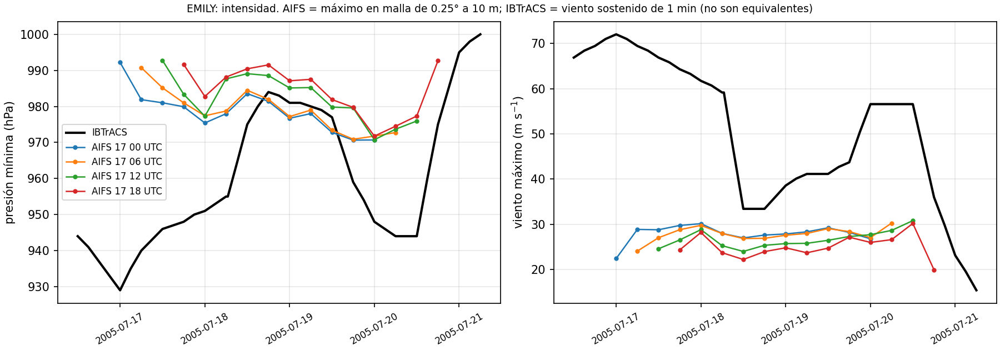
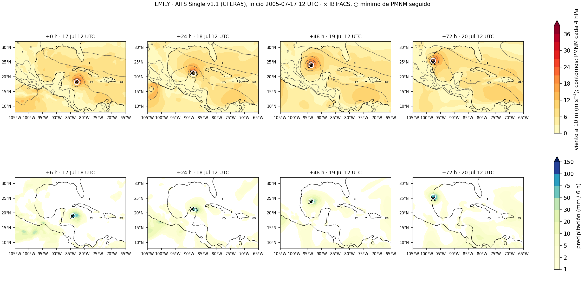

# Block 1 results, 2026-11-08: environment, benchmark and Emily 2005

All runs on Curnagl, partition `gpu` (NVIDIA A100-PCIE-40GB), container
`aifs_single_v2_era5.sif` + `aifs/pylibs/aifs11`.

## 1. Environment

| Check | Result |
|---|---|
| AIFS 1.1 checkpoint with anemoi-models 0.9.3 | Fails: `No module named 'torch_geometric.nn.conv.utils.inspector'` |
| Training provenance in the checkpoint | Python 3.12.1, torch 2.6.0, torch_geometric 2.4.0, anemoi.models 0.4.2.post64 |
| With torch_geometric 2.4.0 + anemoi-models 0.5.0 + anemoi-inference 0.6.3 | Loads: `AnemoiModelInterface`, 253.0 M parameters |
| ERA5 inputs vs checkpoint inputs | No missing or extra variables |
| ERA5 one-day download (CDS) | ~2.5 min; 199 MB per analysis time |

## 2. One-day benchmark (2005-05-15, 4 cycles × 72 h)

| Quantity | Global regrid (job 20308990) | Batched box regrid (job 20309047) |
|---|---|---|
| Wall time per forecast | 52 s | 12.6 s |
| Inference per step | 0.84 s | 0.80 s |
| Regridding per step | 2.3 s | 0.05 s |
| GPU utilisation | 15 % | 44 % |
| Campaign GPU-h (30 % margin) | 325 (420) | 79 (103) |
| Peak VRAM / RAM | 21 / 4.0 GiB | 21 / 5.6 GiB |

Diagnostics:

- `runner.run` does not yield t0 → t0 from ERA5.
- `tp`, `cp`, `tcc` present in the outputs.
- `tp`, `cp` are per 6 h step: domain-mean ratio last/first step 0.94 and 1.00 (an
  accumulation would give ~12); 64 % of points non-decreasing.
- Batched regridding identical to `earthkit.regrid.interpolate` (max relative difference 0.0).
- Maximum tp per step: 100 mm at +6 h → ~30 mm at +72 h (one day; consistent with MSE
  smoothing).

## 3. Emily 2005 (initialisations 2005-07-17 00, 06, 12, 18 UTC; job 20309070)

Centre followed from the IBTrACS position at t0 by the MSLP minimum within 3°; Vmax is
the maximum 10 m wind within 3° of the centre. Not TempestExtremes.

**Track.** The four forecasts follow IBTrACS from the Caribbean across Yucatán and the
Gulf to Tamaulipas, with a slight northward offset over the Gulf for the 00 and 06 UTC
initialisations. Errors per lead: `outputs/figures/emily_2005/emily_errores.csv` on
Curnagl (to add here).

**Intensity.** AIFS Pmin 971–993 hPa against 929–984 hPa (IBTrACS); Vmax 22–31 m s⁻¹
(grid maximum at 0.25°) against 33–72 m s⁻¹ (1 min sustained). The gap is already at t0,
i.e. in ERA5. AIFS reproduces the shape (weakening over Yucatán, re-intensification over
the Gulf) with a much smaller amplitude (~15 hPa against ~55 hPa).

**Fields.** Compact rain core near the centre, maxima ~50–75 mm per 6 h. A closed low at
the western edge (~104°W, 15°N) from 18 July may be Eugene 2005 (eastern Pacific); to
check in IBTrACS EP.

## 4. Implications

1. The 1.1 environment is solved but not yet frozen into a container definition.
2. The campaign costs ~80–100 GPU-h; cost is no longer an argument for 2 cycles per day.
3. Hindcasts with ERA5 inherit weak TC vortices: intensity must be corrected before the
   wind hazard (Block 3), and corrections calibrated on ERA5 hindcasts may over-correct in
   operations (initial-condition shift).
4. Track skill looks good on this case; quantify with TempestExtremes on the campaign.
